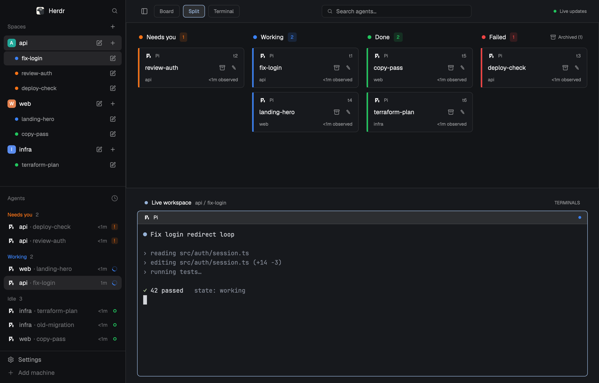

# Agent Columns

A Herdr layout built around a board: every agent is a card in a status column (Needs you, Working, Done, plus Failed and Archived when relevant). The left sidebar lists spaces with their tabs nested underneath, and under it the agents list. Click a card and that agent's live terminals fill the workspace under the board. Sub-agents are drawn inside a framed group, indented under their parent.

## What you see

Left to right: a **sidebar** (268px, `chrome` color, resizable 44-480px) and the **work area**.

**Sidebar**, top to bottom, no divider lines except the footer's:
1. Brand bar, 46px: Herdr logo, "Herdr", and a search button (opens the `picker`). Leaves room for the macOS window buttons.
2. **Spaces**: a "Spaces" header with a `+` (new space). Each space is a row: a rounded 18px colored letter avatar, its name, a pen (rename) and a `+` (new tab). Its tabs are listed under it, indented 24px, each with a status dot (theme `blocked` / `working` / `done`, `dim` when none) and a pen. The active space and tab have the `selected` background.
3. **Agents**: the shipped `agents` list.
4. Footer, 69px: the shipped Settings and Add machine buttons.

**Work area**, top to bottom:
1. **Header**, 48px, `surface` color: a panel icon (hide/show the whole sidebar), three toggle chips **Board / Split / Terminal** (the current one is highlighted in the accent color), a centered 320px **search box** ("Search agents…", with a ✕ while it has text), and a green dot with "Live updates" at the right.
2. **Board**, 355px in Split view: equal-width columns with 16px gaps, 24px side padding. Each column has a status dot, its name and a count. Cards are 86px high, with a 3px status stripe on the left, 7px corners and a `surface` background: program icon and name, terminal address, tab name (13px, semibold; the terminal title when the tab is unnamed), a rename pen and an archive icon, then the space name and "<1m observed" / "Nm observed".
3. **Workspace**: a 34px rail ("Live workspace", "space / tab", "TERMINALS") over the active tab's terminal panes: 12px gaps, 7px corners, 28px headers with program icon and a status dot.

The look follows the person's theme: `paper` when light, `graphite` when dark. Nothing is a fixed hex color except the avatar palette and white avatar letters.

## How it behaves

| Status | Column | Color |
|---|---|---|
| blocked | Needs you | theme `blocked` |
| working | Working | theme `working` |
| done, idle | Done | theme `done` |
| error | Failed | theme `ansi1`; the column exists only while an agent has failed |
| tab settled | Archived | theme `dim`; the column exists only while toggled on |

- **Failed**: Herdr reports a failed agent as `blocked`; the mod reads the real `error` state from `terminals()` (`status` or `report.state`) and moves the card to Failed.
- **Archive**: the archive icon on a card runs `tab.settle` on the agent's tab; archived cards show "Restore" (`tab.unsettle`). The toggle sits inside the board, in the header of its last column: "Archived (N)" or "Hide archived". The Archived column is a normal equal-width column.
- **Click a card**: `agent.focus`, which selects its space and tab. In Board view this also switches to Split.
- **View toggle**: Board hides the workspace and lets the board fill the window; Terminal hides the board; Split shows both (board 355px). The state lives in the layout (`hidden`, size) so it survives restarts.
- **Search**: filters cards by tab name, terminal title, address, program name or space name, case-insensitive. Counts follow. The text is shared state and is not saved.
- **Sub-agents**: a card whose terminal has a `parent` is drawn inside a rounded frame with a faint border in the column's color, 16px indented under its parent, which is full width. When the parent is in another column, the frame has a small `↳ <parent tab name>` header. A parent shows an "N sub-agents" badge while some are live.
- **Ages** refresh every 30s and restart when this board first sees a new status. They are not the agent's real work time.
- **Sidebar**: click a space or tab to select it; pen renames (`space.rename` / `tab.rename`); `+` on a space adds a tab, `+` on the header adds a space; **right-click** a space or tab opens the shipped context menu (rename, close, worktrees, new tab). Settled tabs are hidden from the sidebar.
- The panel icon in the header and `cmd-b` hide and show the whole sidebar. With the sidebar hidden on macOS the header leaves room for the window buttons.
- The app's next/previous agent keys follow column order, left to right, Archived last.

## Built from

- **Layout** `layouts/agent-columns.json`: root `row`, `titlebar: "none"`, `traffic_lights: [12, 16]`, theme `{light: paper, dark: graphite}`, `terminal_padding: [12, 10]`, `preview: "layouts/agent-columns.svg"`. Children: `sidebar` (column, 268px, min 44, max 480, `chrome` background: `brand`, `sidebar-lists` with `spaces` and `agents`, `sidebar-footer`) and `work` (column: `cols-header` 48px, `cols-cards` 355px with a bottom border, `workspace` with `workspace-title` 34px and `live-terminals`, a `{tab: "active"}` block whose pane frame has `header: {mod: "agent-columns", props: {role: "pane"}}`). Ids matter: the mod hides/shows `cols-cards`, `workspace` and `sidebar`.
- **`mods/agent-columns`**, one mod selected by `props().role`: `header`, `terminals` (workspace rail), `pane` (pane header), none (the board). Uses `agents()`, `terminals()`, `spaces()`, `panes()`, `layout()`, `theme()`, `shared()` / `setShared()`, `setAgentOrder()`, and `run` for `agent.focus`, `tab.rename`, `tab.settle`, `tab.unsettle`, `layout.show`, `layout.hide`, `layout.resize`, `layout.toggle`. The search box is an `InputState` created in `init` (it can't be created while rendering). `mod.json`: `{"place": "none"}`.
- **`mods/agent-columns-spaces`**: spaces with nested tabs. Uses `spaces()`, `shared("space.colors")` for the avatar colors, `openOverlay({mod: "menu", kind: "popup", props: {tab: "space" | "tab", target}})` for right-click, and `run` for `space.select`, `space.new`, `space.rename`, `tab.select`, `tab.new`, `tab.rename`. `mod.json`: `{"place": "none", "title": "Spaces"}`.
- **`mods/agent-columns-chrome`**: a clone of the shipped `workspace-chrome` (0.1.11) with its sidebar-fold button removed, so the sidebar can only be hidden whole. Keeps `search.svg`, `settings.svg`, `plus.svg`.
- **Shipped mods it relies on**: `agents` (sidebar list), `workspace-chrome` (footer, and the `archive.svg`, `panel-left.svg` and `search.svg` icons the mods load by path), `menu` (right-click), `picker` (search button).
- No network, no programs, no files outside its own folder.

## Watch out

- `InputState.new` throws if called during render; a hot-reloaded header copy then fails to render. Create it in `init`.
- `layout.hide` / `layout.resize` on the layout's own ids persist as clicks; the layout file's `cols-cards` size is 355px, and Board view sets its weight to 1 until Split sets 355px again.
- Archive is `tab.settle`: it archives the whole tab, so agents sharing a tab archive together. Herdr un-archives a settled tab by itself when its agent needs you.
- Sub-agents come from the terminal's `parent`. `hc run` children have no pane, so they are not in `agents()` and never appear on the board until given a pane (`terminal.keep`).
- A parent that has no pane shows its address instead of a tab name in the `↳` header.
- "Terminal" view keeps only the workspace; the card search does not filter terminals or the sidebar.
- `mods/agent-columns-chrome` is a snapshot clone: it does not follow later `workspace-chrome` updates.

## Done when

- `herdr-app check` passes for each of the three mods, and `layout.switch {name: "agent-columns"}` shows the layout.
- Every agent is in the right column, and each count matches.
- Clicking a card selects its space and tab and the workspace follows.
- Board, Split and Terminal each hide or show the right bands, and a click on a card in Board view returns to Split.
- A failed agent appears in Failed, and the column disappears when none is left.
- Archiving a card moves it to Archived (after toggling it on); Restore moves it back.
- Typing in the search box filters the cards; ✕ restores them.
- A sub-agent sits indented inside its parent's frame.
- The sidebar lists spaces with nested tabs, pens rename them, and right-click opens the context menu.
- The header's panel icon and `cmd-b` hide and show the whole sidebar, and dragging its edge resizes it.
